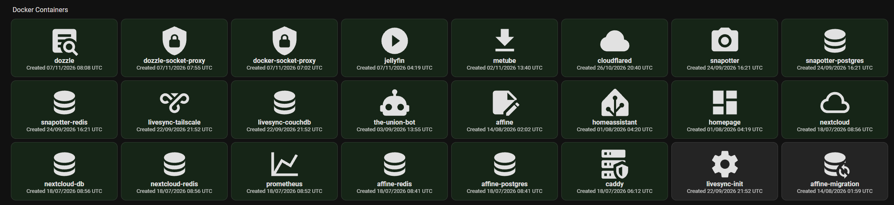

# HomeAssistant Monitoring

#### 7th November 2026 @ 6:47AM

It has been a couple months of using my home server and so far it's been very useful. Combined with tailscale I have been able to browse my own media, whether its my large library of photos and videos. I've even finished off Game of Thrones, a show I started watching about 4 years ago but never made it past season 2!

I have made some unnoted changes since I last wrote such as using Caddy's certificate for HTTPS. I may go back to write about this at some point but for now I want to setup my Home Assistant container


## HomeAssistant's responsibilities?

Whilst I could do everything manually through each container's app or a terminal, I want to simplify the actions and analytics to a single page (plus I've heard it's good to show off to an interviewer).

Here are some of the things we'll look to make it do:

* Starting, stopping and restarting Docker containers.
* Monitoring Docker health and resource usage.
* Checking for image updates.
* Applying updates when I authorise them.
* Monitoring external services and infrastructure.
* Sending notifications when something fails.
* Controlling AMP game instances.
* Running scheduled maintenance tasks.

Not all of these may be possible but we will reflect that at the end.

## HomeAssistant Dashboard & prerequisites

I had only briefly used Home Assistant to make a script to wake my PC up via LAN so I could remotely connect to it via moonlight & sunshine. Now I need to add a new dashboard from the settings page and set it as the default. This will replace the standard "overview" page.

<figure><figcaption></figcaption></figure>

Editing this page, I have added 3 sections for now: System Status; Docker Containers and Infrastructure. We can add more later if we need to.

## Connecting Docker to HomeAssistant

We can use a Docker Socket Proxy to connect the two together safely without giving HomeAssistant root access. I used to use watchtower to continuously update one of my containers this way but I had forgotten to keep it updated which stopped it from working. Sounds like kind of a counter-intuitive idea back then...&#x20;


The Docker Socket Proxy will act as a Read-only API giving Docker container information for the time being via the Docker host's loopback interface. Once we have fully set it up then we can upgrade the system to act as a control point.



```docker
services:
  docker-socket-proxy:
    image: ghcr.io/tecnativa/docker-socket-proxy:latest
    container_name: docker-socket-proxy
    restart: unless-stopped

    environment:
      CONTAINERS: "1"
      EVENTS: "1"
      INFO: "1"
      IMAGES: "1"
      NETWORKS: "1"
      PING: "1"
      VERSION: "1"

      POST: "0"
      AUTH: "0"
      SECRETS: "0"
      EXEC: "0"
      VOLUMES: "0"

    volumes:
      - /var/run/docker.sock:/var/run/docker.sock:ro

    ports:
      - "127.0.0.1:2375:2375"
```


To confirm it works after running


```shellscript
curl http://127.0.0.1:2375/_ping
```


outputting OK

We can start with monitoring container states before moving onto CPU, memory and other hardware information.&#x20;


```yaml

# ----------------------------------------------------
# Stuff that was already in here before
# ----------------------------------------------------

# Loads default set of integrations. Do not remove.
default_config:

# Load frontend themes from the themes folder
frontend:
  themes: !include_dir_merge_named themes

automation: !include automations.yaml
script: !include scripts.yaml
scene: !include scenes.yaml

http:
  use_x_forwarded_for: true
  trusted_proxies:
    - 172.20.0.0/16

wake_on_lan:

switch:
  - platform: wake_on_lan
    name: Gaming PC
    mac: "9C:6B:00:17:76:DD"
    host: "192.168.0.200"
    broadcast_address: "192.168.0.255"
    broadcast_port: 9
    
    
# ---------------------
# New code


rest:
  - resource: http://127.0.0.1:2375/containers/json?all=1
    method: GET
    scan_interval: 30
    sensor:
      - name: "Docker Containers"
        unique_id: docker_containers
        value_template: "{{ value_json | count }}"

      - name: "Docker Running Containers"
        unique_id: docker_running_containers
        value_template: "{{ value_json | selectattr('State', 'equalto', 'running') | list | count }}"

      - name: "Docker Stopped Containers"
        unique_id: docker_stopped_containers
        value_template: "{{ value_json | rejectattr('State', 'equalto', 'running') | list | count }}"

```


then:


```shellscript
docker restart homeassistant
```


Now visiting HomeAssistant's Settings > Developer Tools > States (along the top) and filtering entities for "docker\_" will show us the 3 added sensors with their states/values:&#x20;

* sensor.docker\_containers: 24 (total containers)&#x20;
* sensor.docker\_running\_containers: 20
* sensor.docker\_stopped\_containers: 4&#x20;

These values will of course be different for someone else's home server.

These can now be added to the dashboard. Under the Docker Container card:

* Click the plus&#x20;
* Select the "By card" header
* Search and find the card labelled "Entities"

<figure><figcaption></figcaption></figure>

Given the context of the card's name "Docker Containers" you can edit each row, simplifying the labels

<figure><figcaption></figcaption></figure>

This is a very very simple method of monitoring our containers. We can take this a step further by showing a live inventory of containers, their statuses, their image, and restart status.



```python
import json
import urllib.request
from datetime import datetime, timezone

url = "http://127.0.0.1:2375/containers/json?all=1"

with urllib.request.urlopen(url, timeout=10) as response:
    docker_data = json.load(response)

containers = []

for container in docker_data:
    containers.append({
        "name": container["Names"][0].lstrip("/"),
        "image": container["Image"],
        "state": container["State"],
        "status": container["Status"],
        "created": container["Created"],
        "created_date": datetime.fromtimestamp(
            container["Created"], timezone.utc
        ).strftime("%d/%m/%Y %H:%M UTC")
    })

containers.sort(key=lambda item: item["created"], reverse=True)

print(json.dumps({"containers": containers}))
```


This script will help query the docker API, retrieve all containers and in alphabetical order of names return their name, image, state and status.

We can append the config for homeassistant to add this as a sensor


```yaml
# ... existing code from before

command_line:
  - sensor:
      name: Docker Container Inventory
      unique_id: docker_container_inventory
      command: "python3 /config/docker_inventory.py"
      command_timeout: 15
      scan_interval: 30
      value_template: "{{ value_json.containers | count }}"
      json_attributes:
        - containers
```


Using a markdown card in the dashboard we can display all our containers through the code editor


```yaml
type: markdown
title: Docker Container Inventory
content: >
  **{{ states('sensor.docker_container_inventory') }} containers**


  | Container | State | Created | Image |

  |:---|:---:|:---|:---|

  

  

  | `{{ c.name }}` | {{ c.state }} | {{ c.created_date }} | `{{ c.image }}` |

  
grid_options:
  columns: 24
  rows: auto

```


<figure><figcaption></figcaption></figure>

For the purpose of the image, I have resized the card. It might look unfinished for now but at least we know it works! We can also remove the first card now

Now I want to add 3 things

* Clicking on the name of the container takes you to the service
* Clicking on the state of the container takes you to its logs
* Colour coding on the states


### Read-Only Logs

For the logs we can use something called Dozzle which lets you follow logs in real time.

To keep things secure, we'll need a second proxy for Dozzle as CONTAINERS=1 (Socket Proxy connection) also permits GET access to read container filesystems, export filesystems, and inspect process arguments.


```docker
services:
  dozzle-socket-proxy:
    image: lscr.io/linuxserver/socket-proxy:latest
    container_name: dozzle-socket-proxy
    restart: unless-stopped

    environment:
      CONTAINERS: "1"
      EVENTS: "1"
      INFO: "1"
      PING: "1"
      VERSION: "1"

      ALLOW_LOGS: "1"
      ALLOW_ARCHIVE: "0"
      ALLOW_CHANGES: "0"
      ALLOW_EXPORT: "0"
      ALLOW_TOP: "0"
      ALLOW_START: "0"
      ALLOW_STOP: "0"
      ALLOW_RESTARTS: "0"
      ALLOW_PAUSE: "0"
      ALLOW_UNPAUSE: "0"

      POST: "0"
      AUTH: "0"
      EXEC: "0"
      IMAGES: "0"
      NETWORKS: "0"
      VOLUMES: "0"
      SECRETS: "0"

    volumes:
      - /var/run/docker.sock:/var/run/docker.sock:ro

    group_add:
      - "986"

    read_only: true

    tmpfs:
      - /run

    networks:
      - dozzle-backend

networks:
  dozzle-backend:
    name: dozzle-backend
    driver: bridge
```


This proxy has no published ports

Once this proxy is running, we just need to check two things

* Can it list containers


```shellscript
docker exec dozzle-socket-proxy sh -c 'wget -qO- http://127.0.0.1:2375/_ping'
```


it responds with `OK` meaning it's all good

* Does it have the right permissions?

Expecting Success:


```shellscript
docker exec dozzle-socket-proxy sh -c 'wget -qO- "http://127.0.0.1:2375/containers/json?all=1" | head -c 500'
```



```shellscript
docker exec dozzle-socket-proxy sh -c 'wget -qO- "http://127.0.0.1:2375/containers/homeassistant/logs?stdout=1&stderr=1&tail=5"'
```


Expecting Denial:


```shellscript
docker exec dozzle-socket-proxy sh -c 'wget -S -O- "http://127.0.0.1:2375/containers/homeassistant/archive?path=/etc/passwd" 2>&1'
```



```shellscript
docker exec dozzle-socket-proxy sh -c 'wget -S -O- "http://127.0.0.1:2375/containers/homeassistant/top" 2>&1'
```



Now we can create a Dozzle login


```shellscript
mkdir -p /opt/docker/dozzle/data
```



```shellscript
cd /opt/docker/dozzle

docker run --rm amir20/dozzle:latest generate admin --password 'YOUR_NEW_PASSWORD' > ./data/users.yml
```


this password may be stored in your shell history so you can alternatively use&#x20;


```shellscript
read -rsp "New Dozzle password: " DOZZLE_PASSWORD
echo
docker run --rm amir20/dozzle:latest generate admin --password "$DOZZLE_PASSWORD" > ./data/users.yml
unset DOZZLE_PASSWORD
```



```docker
services:
  dozzle:
    image: amir20/dozzle:latest
    container_name: dozzle
    restart: unless-stopped

    environment:
      DOZZLE_REMOTE_HOST: tcp://dozzle-socket-proxy:2375
      DOZZLE_AUTH_PROVIDER: simple

    volumes:
      - ./data:/data

    networks:
      - proxy
      - dozzle-backend

networks:
  proxy:
    external: true

  dozzle-backend:
    external: true
```



```
...

dockerlogs.imanizadyar.com {
    tls internal
    reverse_proxy dozzle:8080
}
```


Then do your usual&#x20;


```
docker exec caddy caddy validate --config /etc/caddy/Caddyfile --adapter caddyfile
```


and if valid:


```
docker exec caddy caddy reload --config /etc/caddy/Caddyfile --adapter caddyfile
```


Then add your dns to your local dns records via pi-hole. Mine is dockerlogs.imanizadyar.com @ 192.168.0.50

Now using your admin login you setup, login to Dozzle at your newly created local DNS url.

<figure><figcaption></figcaption></figure>

and now we can make the changes for the dashboard, replacing your old markdown card code:


```yaml

type: markdown
content: |
  **{{ states('sensor.docker_container_inventory') }} containers**

  | Container | State | Created | Image |
  |:---|:---:|:---|:---|
  
  
  
  
  
    
  
    
  
    
  
    
  
  | [{{ c.name }}]({{ service_url }})`{{ c.name }}` | [{{ indicator }} {{ c.state }}](https://dockerlogs.imanizadyar.com/show?name={{ c.name }}) | {{ c.created_date }} | `{{ c.image }}` |
  
grid_options:
  columns: 24
  rows: auto

```


<figure><figcaption></figcaption></figure>

Now this is totally acceptable and will definitely work. Clicking the names leads you to the services and the status leads you to the logs. From a technical point of view, the docker containers have successfully been moved to the home assistant page.

I want to make this look a bit more visually appealing so I will make use of HomeAssistant Community Store (HACS). I don't remember how I installed it but the guides out there are pretty easy. Once installed, using the button-card @ RomRider and auto-entities @ thomasloven repos, you can take your cards to the next level with the following Auto Entities card configuration. ENSURE you are on the code editor in the bottom left of the configuration.


```yaml
type: custom:auto-entities
card:
  type: grid
  columns: 8
  square: false
card_param: cards
show_empty: false
filter:
  template: |
    [
      
      
      
      
      
      
      
      
      {% set icons = {
        'homeassistant': 'mdi:home-assistant',
        'homepage': 'mdi:view-dashboard',
        'jellyfin': 'mdi:play-circle',
        'metube': 'mdi:download',
        'cloudflared': 'mdi:cloud',
        'snapotter': 'mdi:camera',
        'snapotter-postgres': 'mdi:database',
        'snapotter-redis': 'mdi:database',
        'nextcloud': 'mdi:cloud-outline',
        'nextcloud-db': 'mdi:database',
        'nextcloud-redis': 'mdi:database',
        'affine': 'mdi:note-edit',
        'affine-postgres': 'mdi:database',
        'affine-redis': 'mdi:database',
        'affine-migration': 'mdi:database-sync',
        'prometheus': 'mdi:chart-line',
        'dozzle': 'mdi:text-box-search',
        'dozzle-socket-proxy': 'mdi:shield-lock',
        'docker-socket-proxy': 'mdi:shield-lock',
        'livesync-couchdb': 'mdi:database',
        'livesync-tailscale': 'mdi:vpn',
        'livesync-init': 'mdi:cog',
        'the-union-bot': 'mdi:robot',
        'caddy': 'mdi:server-security'
      } %}
      {% set services = {
        'homeassistant': 'https://homeassistant.imanizadyar.com',
        'homepage': 'https://dashboard.imanizadyar.com',
        'jellyfin': 'https://jellyfin.imanizadyar.com',
        'affine': 'https://affine.imanizadyar.com',
        'nextcloud': 'https://nextcloud.imanizadyar.com',
        'prometheus': 'https://prometheus.imanizadyar.com',
        'metube': 'https://metube.imanizadyar.com',
        'snapotter': 'https://snapotter.imanizadyar.com',
        'dozzle': 'https://dockerlogs.imanizadyar.com'
      } %}
      
        
        
        
        {{
          {
            'type': 'custom:button-card',
            'entity': 'sensor.docker_container_inventory',
            'name': c.name,
            'icon': icons.get(c.name, 'mdi:docker'),
            'show_state': false,
            'show_label': true,
            'label': status | upper ~ ' · ' ~ image ~ ' · Created ' ~ c.created_date,
            'tap_action': {
              'action': 'url',
              'url_path': services.get(c.name, 'https://dockerlogs.imanizadyar.com/show?name=' ~ c.name)
            },
            'hold_action': {
              'action': 'url',
              'url_path': 'https://dockerlogs.imanizadyar.com/show?name=' ~ c.name
            },

            'styles': {
              'card': [
                {'background-color': colour},
                {'padding': '14px'},
                {'height': '140px'},
                {'border-radius': '12px'}
              ],
              'name': [
                {'font-size': '16px'},
                {'font-weight': '600'},
                {'white-space': 'normal'},
                {'overflow-wrap': 'anywhere'}
              ],
              'label': [
                {'font-size': '13px'},
                {'white-space': 'normal'},
                {'opacity': '0.85'}
              ],

            }
          }
        }},
      
    ]
grid_options:
  columns: 48
  rows: auto

```


One thing you may note here is that I have manually assigned icons and services. This could be passed through the docker compose however since I do not constantly need services and icons updated on the home page, I will not go through the hassle. The columns at the top have been customised for my home page as you can see below

<figure><figcaption></figcaption></figure>

Clicking on a container will take you to its service (if it has one) otherwise holding it will take you to its logs.

When removing my two red testing containers through the shell, they disappeared almost immediately on homeassistant without having to refresh.


We can monitor two more things using the python script:

* health: healthy, unhealthy, starting, or not\_configured
* restart\_count: how many times docker has restarted a container


```python
import json
import urllib.request
from datetime import datetime, timezone

base_url = "http://127.0.0.1:2375"

# Retrieve all containers, including stopped ones.
with urllib.request.urlopen(
    f"{base_url}/containers/json?all=1",
    timeout=10
) as response:
    docker_data = json.load(response)

containers = []

for container in docker_data:
    container_id = container["Id"]

    # Inspect each container for health and restart information.
    with urllib.request.urlopen(
        f"{base_url}/containers/{container_id}/json",
        timeout=10
    ) as response:
        details = json.load(response)

    state = details["State"]
    health_data = state.get("Health")

    containers.append({
        "name": container["Names"][0].lstrip("/"),
        "image": container["Image"],
        "state": container["State"],
        "status": container["Status"],
        "created": container["Created"],
        "created_date": datetime.fromtimestamp(
            container["Created"], timezone.utc
        ).strftime("%d/%m/%Y %H:%M UTC"),
        "health": (
            health_data["Status"]
            if health_data
            else "not_configured"
        ),
        "restart_count": details["RestartCount"]
    })

# Newest containers first.
containers.sort(
    key=lambda item: item["created"],
    reverse=True
)

print(json.dumps({"containers": containers}))
```


The state on homeassistant will automatically update health and restart\_count, we just need to update the card.

We can use the state of a container combined with its health to identify if its healthy or not

| Docker state              | Dashboard label |
| ------------------------- | --------------- |
| Running + healthy         | `HEALTHY`       |
| Running + unhealthy       | `UNHEALTHY`     |
| Running + starting        | `STARTING`      |
| Running + no health check | `RUNNING`       |
| Stopped                   | `EXITED`        |

The only one here that doesn't confirm a container's status is the `running + no health check` but we can use the restarts value to somewhat close in on any issues. Normally the restarts value is across the container's lifetime but we can change its scope to only look for restarts within the last 15 minutes (configurable of course).



```python
import json
import os
import tempfile
import time
import urllib.request
from datetime import datetime, timezone

base_url = "http://127.0.0.1:2375"
history_path = "/config/docker_restart_history.json"
window_seconds = 15 * 60

now = time.time()

# Load previously observed restart counts and timestamps.
try:
    with open(history_path, "r") as file:
        restart_history = json.load(file)
except FileNotFoundError:
    restart_history = {}

# Retrieve all containers, including stopped ones.
with urllib.request.urlopen(
    f"{base_url}/containers/json?all=1",
    timeout=10
) as response:
    docker_data = json.load(response)

containers = []
updated_history = {}

for container in docker_data:
    container_id = container["Id"]

    # Retrieve detailed container information.
    with urllib.request.urlopen(
        f"{base_url}/containers/{container_id}/json",
        timeout=10
    ) as response:
        details = json.load(response)

    state = details["State"]
    health_data = state.get("Health")
    restart_count = details["RestartCount"]

    # Retrieve the previous restart history for this container.
    previous = restart_history.get(container_id, {})
    previous_count = previous.get("restart_count", restart_count)
    events = previous.get("events", [])

    # Detect newly observed restarts.
    if restart_count > previous_count:
        events.extend([now] * (restart_count - previous_count))

    # If the counter resets, establish a new baseline.
    elif restart_count < previous_count:
        events = []

    # Keep only events from the last 15 minutes.
    events = [
        timestamp for timestamp in events
        if now - timestamp <= window_seconds
    ]

    updated_history[container_id] = {
        "restart_count": restart_count,
        "events": events
    }

    containers.append({
        "name": container["Names"][0].lstrip("/"),
        "image": container["Image"],
        "state": container["State"],
        "status": container["Status"],
        "created": container["Created"],
        "created_date": datetime.fromtimestamp(
            container["Created"], timezone.utc
        ).strftime("%d/%m/%Y %H:%M UTC"),
        "health": (
            health_data["Status"]
            if health_data
            else "not_configured"
        ),
        "restart_count": restart_count,
        "restarts_15m": len(events)
    })

# Save the history atomically to avoid leaving a partially written file.
with tempfile.NamedTemporaryFile(
    mode="w",
    dir="/config",
    prefix=".docker_restart_history.",
    delete=False
) as file:
    json.dump(updated_history, file)
    temporary_path = file.name

os.replace(temporary_path, history_path)

# Newest containers first.
containers.sort(
    key=lambda item: item["created"],
    reverse=True
)

print(json.dumps({"containers": containers}))
```


So now it can compare between iterations how many times it has restarted and discards information past 15 minutes. This is helped with a `docker_restart_history.json`&#x20;

Now here is the updated card configuration. Once again ENSURE you are in the code editor:


```yaml
type: custom:auto-entities
card:
  type: grid
  columns: 8
  square: false
card_param: cards
show_empty: false
filter:
  template: |
    [
      
      
      
      
      
      
      
      
      {% set icons = {
        'homeassistant': 'mdi:home-assistant',
        'homepage': 'mdi:view-dashboard',
        'jellyfin': 'mdi:play-circle',
        'metube': 'mdi:download',
        'cloudflared': 'mdi:cloud',
        'snapotter': 'mdi:camera',
        'snapotter-postgres': 'mdi:database',
        'snapotter-redis': 'mdi:database',
        'nextcloud': 'mdi:cloud-outline',
        'nextcloud-db': 'mdi:database',
        'nextcloud-redis': 'mdi:database',
        'affine': 'mdi:note-edit',
        'affine-postgres': 'mdi:database',
        'affine-redis': 'mdi:database',
        'affine-migration': 'mdi:database-sync',
        'prometheus': 'mdi:chart-line',
        'dozzle': 'mdi:text-box-search',
        'dozzle-socket-proxy': 'mdi:shield-lock',
        'docker-socket-proxy': 'mdi:shield-lock',
        'livesync-couchdb': 'mdi:database',
        'livesync-tailscale': 'mdi:vpn',
        'livesync-init': 'mdi:cog',
        'the-union-bot': 'mdi:robot',
        'caddy': 'mdi:server-security'
      } %}
      {% set services = {
        'homeassistant': 'https://homeassistant.imanizadyar.com',
        'homepage': 'https://dashboard.imanizadyar.com',
        'jellyfin': 'https://jellyfin.imanizadyar.com',
        'affine': 'https://affine.imanizadyar.com',
        'nextcloud': 'https://nextcloud.imanizadyar.com',
        'prometheus': 'https://prometheus.imanizadyar.com',
        'metube': 'https://metube.imanizadyar.com',
        'snapotter': 'https://snapotter.imanizadyar.com',
        'dozzle': 'https://dockerlogs.imanizadyar.com'
      } %}
      
      
      
      
      
      
        {{
          {
            'type': 'custom:button-card',
            'entity': 'sensor.docker_container_inventory',
            'name': c.name,
            'icon': icons.get(c.name, 'mdi:docker'),
            'show_state': false,
            'show_label': true,
            'label': (
              ('UNHEALTHY' if health == 'unhealthy' else
               'STARTING' if health == 'starting' else
               'EXITED' if status == 'exited' and c.name not in init_names else
               'RESTART WARNING: ' ~ (restarts_15m | string) ~ '/15M' if restarts_15m >= 3 else
               'RESTARTS: ' ~ (restarts_15m | string) ~ '/15M' if restarts_15m > 0 else
               '')
              ~ (' · ' if (health == 'unhealthy' or health == 'starting' or (status == 'exited' and c.name not in init_names) or restarts_15m > 0) else '')
              ~ 'Created ' ~ c.created_date
            ),
            'tap_action': {
              'action': 'url',
              'url_path': services.get(c.name, 'https://dockerlogs.imanizadyar.com/show?name=' ~ c.name)
            },
            'hold_action': {
              'action': 'url',
              'url_path': 'https://dockerlogs.imanizadyar.com/show?name=' ~ c.name
            },

            'styles': {
              'card': [
                {'background-color': colour},
                {'padding': '14px'},
                {'height': '140px'},
                {'border-radius': '12px'}
              ],
              'name': [
                {'font-size': '16px'},
                {'font-weight': '600'},
                {'white-space': 'normal'},
                {'overflow-wrap': 'anywhere'}
              ],
              'label': [
                {'font-size': '13px'},
                {'white-space': 'normal'},
                {'opacity': '0.85'}
              ],

            }
          }
        }},
      
    ]
grid_options:
  columns: 48
  rows: auto

```


<figure><figcaption></figcaption></figure>

As you can see, the images are no longer present and if a container is healthy or ignored (for example the two initialisation containers) they do not show their state. \
The final conditions are as follows:

| Condition                  | Label                    |
| -------------------------- | ------------------------ |
| Healthy                    | No health label          |
| Running, no health check   | No health label          |
| Starting                   | `STARTING`               |
| Unhealthy                  | `UNHEALTHY`              |
| 1–2 restarts in 15 minutes | `RESTARTS: 2/15M`        |
| 3+ restarts in 15 minutes  | `RESTART WARNING: 3/15M` |
| Unexpectedly exited        | `EXITED`                 |
| Intentionally exited       | No warning label         |

## HomeAssistant Notifications

My first set of notification automations will regard the health system we just created. If one container becomes unhealthy a notification is sent to my phone and if I need to I can have the notification repeated in an hour or the next day. If 3 containers go down within the hour then send a critical notification to my phone.

| Event                                         | Severity       | Behaviour                                      |
| --------------------------------------------- | -------------- | ---------------------------------------------- |
| Container becomes unhealthy                   | Critical       | Immediate notification                         |
| Container unexpectedly stops                  | Critical       | Immediate notification                         |
| 3+ restarts within 15 minutes                 | Warning        | Immediate notification                         |
| Container enters starting state               | Warning        | Notify if it doesn't recover within 60 minutes |
| 3+ containers unexpectedly stop within 1 hour | Crticial Alert | Critical infrastructure notification           |

HomeAssistant uses the action `notify.mobile_app_iphone` to reach my iphone and I tested out the critical notification via dev tools


```
action: notify.mobile_app_iphone
data:
  title: "Docker Critical Alert Test"
  message: "Testing critical notification delivery."
  data:
    push:
      sound:
        name: default
        critical: 1
        volume: 1.0
```


It worked (and it was loud).

To track which containers have already sent alerts, we'll need to create a Text Helper otherwise we will receive notifications every 30 seconds. This is done via settings > devices & services > Helpers (at top). Its ID is `input_text.docker_active_alerts` with a max length of 255 characters.

Another Text Helper will track failure events for distinct container counting over the rolling hour: `input_text.failure_history`


We can now make the first automation: Docker - Container Problem Detection


```
alias: Docker - Container Problem Detection
description: Detect Docker problems, send actionable alerts and track unexpected stops.
triggers:
  - trigger: time_pattern
    minutes: /1
conditions: []
actions:
  - variables:
      containers: >-
        {{ state_attr('sensor.docker_container_inventory', 'containers') or []
        }}
      active_names: |-
        {{ states('input_text.docker_active_alerts').split(',')
           if states('input_text.docker_active_alerts') not in ['', 'unknown', 'unavailable']
           else [] }}
      history_raw: |-
        {{ states('input_text.failure_history')
           if states('input_text.failure_history') not in ['', 'unknown', 'unavailable']
           else '' }}
  - variables:
      current_issues: |-
          
          
          
          
          
            
          
         {{ ns.names | unique | list }}
  - variables:
      new_issues: "{{ current_issues | reject('in', active_names) | list }}"
      recent_history: >-
         
          
            
            
              
            
          
         {{ ns.entries }}
  - variables:
      recent_failure_names: |-
         
          
          
         {{ ns.names }}
      new_history: >-
         
          
          
            
          
         {{ ns.entries }}
      critical_trigger: "{{ recent_history | count < 3 and new_history | count >= 3 }}"
  - repeat:
      for_each: "{{ new_issues }}"
      sequence:
        - action: notify.mobile_app_iphone
          data:
            title: Docker Container Alert
            message: >-
               
                {{ repeat.item }} has become unhealthy.
              
                {{ repeat.item }} has remained in the starting state for over an hour.
              
                {{ repeat.item }} has unexpectedly stopped.
              
                {{ repeat.item }} has not started after an hour.
              
                {{ repeat.item }} has restarted at least 3 times within 15 minutes.
              
            data:
              actions:
                - action: "{{ 'DOCKER_REMIND_1H_' ~ repeat.item }}"
                  title: Remind me in 1 hour
                - action: "{{ 'DOCKER_REMIND_TOMORROW_' ~ repeat.item }}"
                  title: Remind me tomorrow at 11:00
  - action: input_text.set_value
    target:
      entity_id: input_text.failure_history
    data:
      value: "{{ new_history | join(',') }}"
  - if:
      - condition: template
        value_template: "{{ critical_trigger | bool }}"
    then:
      - action: notify.mobile_app_iphone
        data:
          title: "CRITICAL: Multiple Docker Failures"
          message: >-
            Three or more distinct Docker containers have unexpectedly stopped
            within the last hour. Check your Home Assistant Docker dashboard.
          data:
            push:
              sound:
                name: default
                critical: 1
                volume: 1
  - action: input_text.set_value
    target:
      entity_id: input_text.docker_active_alerts
    data:
      value: "{{ current_issues | join(',') }}"
mode: single

```


and after some testing with some test scripts


```
alias: TEST - Docker Notifications
description: Tests Docker alerts and actionable notification buttons.
sequence:
  - variables:
      test_containers:
        - name: jellyfin
          health: unhealthy
          state: running
        - name: nextcloud
          health: not_configured
          state: exited
  - repeat:
      for_each: "{{ test_containers }}"
      sequence:
        - action: notify.mobile_app_iphone
          data:
            title: Docker Container Alert (TEST)
            message: |-
              
                TEST: {{ repeat.item.name }} has become unhealthy.
              
                TEST: {{ repeat.item.name }} has unexpectedly stopped.
              
            data:
              actions:
                - action: "{{ 'DOCKER_REMIND_1H_' ~ repeat.item.name }}"
                  title: Remind me in 1 hour
                - action: "{{ 'DOCKER_REMIND_TOMORROW_' ~ repeat.item.name }}"
                  title: Remind me tomorrow at 11:00
                - action: "{{ 'DOCKER_TEST_REMIND_1M_' ~ repeat.item.name }}"
                  title: "TEST: Remind me in 1 minute"
mode: single

```



```
alias: TEST - Docker Critical Alert
description: Simulates three distinct Docker container failures.
sequence:
  - variables:
      fake_containers:
        - name: jellyfin
          state: exited
        - name: nextcloud
          state: exited
        - name: prometheus
          state: exited
  - variables:
      simulated_failures: |-
         
          
            
          
         {{ ns.names | unique | list }}
  - if:
      - condition: template
        value_template: "{{ simulated_failures | count >= 3 }}"
    then:
      - action: notify.mobile_app_iphone
        data:
          title: "CRITICAL: Multiple Docker Failures (TEST)"
          message: >-
            TEST: Three distinct Docker containers have unexpectedly stopped
            within the last hour.
          data:
            push:
              sound:
                name: default
                critical: 1
                volume: 1
mode: single

```


It seems to be working!


#### 8th November 2026 @ 4:48AM

## Controlling containers remotely

Using a third proxy I can:

* Start containers
* Stop containers

Without being able to:

* Execute commands
* Image management


```yml
services:
  docker-control-proxy:
    image: ghcr.io/tecnativa/docker-socket-proxy:latest
    container_name: docker-control-proxy
    restart: unless-stopped

    environment:
      POST: "1"

      CONTAINERS: "0"
      ALLOW_START: "1"
      ALLOW_STOP: "1"
      ALLOW_RESTARTS: "0"

      AUTH: "0"
      SECRETS: "0"
      BUILD: "0"
      COMMIT: "0"
      CONFIGS: "0"
      DISTRIBUTION: "0"
      EVENTS: "0"
      EXEC: "0"
      GRPC: "0"
      IMAGES: "0"
      INFO: "0"
      NETWORKS: "0"
      NODES: "0"
      PING: "1"
      PLUGINS: "0"
      SERVICES: "0"
      SESSION: "0"
      SWARM: "0"
      SYSTEM: "0"
      TASKS: "0"
      VERSION: "1"
      VOLUMES: "0"

    volumes:
      - /var/run/docker.sock:/var/run/docker.sock:ro

    ports:
      - "127.0.0.1:2376:2375"
```


HTTP 200:


```
curl -i http://127.0.0.1:2376/_ping
```


HTTP 403:


```
curl -i http://127.0.0.1:2376/containers/json
```




```yaml
...

rest_command:
  docker_start_container:
    url: "http://127.0.0.1:2376/containers/{{ container_id }}/start"
    method: POST

  docker_stop_container:
    url: "http://127.0.0.1:2376/containers/{{ container_id }}/stop"
    method: POST
```


Then restart HomeAssistant


These can be tested in Dev Tools > Actions


```yaml
action: rest_command.docker_start_container
data:
    container_id: "affine"
```



```yaml
action: rest_command.docker_stop_container
data: 
    container_id: "affine"
```



Then we can add a restart script


```yaml
alias: Docker - Restart Container
description: Stop and start a Docker container through the restricted control proxy.
mode: parallel
max: 10

fields:
  container_id:
    name: Container ID
    description: Full Docker container ID
    required: true
    selector:
      text:

sequence:
  - action: rest_command.docker_stop_container
    data:
      container_id: "{{ container_id }}"

  - action: rest_command.docker_start_container
    data:
      container_id: "{{ container_id }}"
```


and it can be tested the same way as before

<figure><figcaption></figcaption></figure>

We can also trace the script to confirm it worked

<figure><figcaption></figcaption></figure>


Installing Browser Mod from HACS (or what is now known as just the marketplace with their latest update 2026.11.0), we can make use of interactive pop up menus. This helps up map more actions per card for both my PC and iOS.

We need to make a patch to expose the docker id to target the correct container when performing actions


```shellscript
python3 - <<'PY'
from pathlib import Path

path = Path("/opt/docker/homeassistant/config/docker_inventory.py")
content = path.read_text()

old = '''    containers.append({
        "name": container["Names"][0].lstrip("/"),
        "image": container["Image"],'''

new = '''    containers.append({
        "name": container["Names"][0].lstrip("/"),
        "id": container_id,
        "image": container["Image"],'''

if old not in content:
    raise SystemExit("Expected code not found; no changes made.")

path.write_text(content.replace(old, new, 1))
print("Docker container IDs added to inventory.")
PY
```


Then we end up with a final Auto Entities card configuration. ENSURE code editor


```yaml
type: custom:auto-entities
card:
  type: grid
  columns: 8
  square: false
card_param: cards
show_empty: false
filter:
  template: |
    [
      
      

      
      
      
      
      
      
      
      {% set icons = {
        'homeassistant': 'mdi:home-assistant',
        'homepage': 'mdi:view-dashboard',
        'jellyfin': 'mdi:play-circle',
        'metube': 'mdi:download',
        'cloudflared': 'mdi:cloud',
        'snapotter': 'mdi:camera',
        'snapotter-postgres': 'mdi:database',
        'snapotter-redis': 'mdi:database',
        'nextcloud': 'mdi:cloud-outline',
        'nextcloud-db': 'mdi:database',
        'nextcloud-redis': 'mdi:database',
        'affine': 'mdi:note-edit',
        'affine-postgres': 'mdi:database',
        'affine-redis': 'mdi:database',
        'affine-migration': 'mdi:database-sync',
        'prometheus': 'mdi:chart-line',
        'dozzle': 'mdi:text-box-search',
        'dozzle-socket-proxy': 'mdi:shield-lock',
        'docker-socket-proxy': 'mdi:shield-lock',
        'livesync-couchdb': 'mdi:database',
        'livesync-tailscale': 'mdi:vpn',
        'livesync-init': 'mdi:cog',
        'the-union-bot': 'mdi:robot',
        'caddy': 'mdi:server-security'
      } %}
      {% set services = {
        'homeassistant': 'https://homeassistant.imanizadyar.com',
        'homepage': 'https://dashboard.imanizadyar.com',
        'jellyfin': 'https://jellyfin.imanizadyar.com',
        'affine': 'https://affine.imanizadyar.com',
        'nextcloud': 'https://nextcloud.imanizadyar.com',
        'prometheus': 'https://prometheus.imanizadyar.com',
        'metube': 'https://metube.imanizadyar.com',
        'snapotter': 'https://snapotter.imanizadyar.com',
        'dozzle': 'https://dockerlogs.imanizadyar.com'
      } %}
      
      
      
      
      
      
      
      
      
        {% set menu_cards = menu_cards + [
        {
          'type': 'button',
          'name': 'Stop',
          'icon': 'mdi:stop-circle-outline',
          'tap_action': {
            'action': 'fire-dom-event',
            'browser_mod': {
              'service': 'script.docker_container_action',
              'data': {
                'container_id': c.id,
                'operation': 'stop',
                'browser_id': 'THIS'
              }
            },
            'confirmation': {
              'text': 'Are you sure you want to stop ' ~ c.name ~ '?'
            }
          }
        },
        {
          'type': 'button',
          'name': 'Restart',
          'icon': 'mdi:restart',
          'tap_action': {
            'action': 'fire-dom-event',
            'browser_mod': {
              'service': 'script.docker_container_action',
              'data': {
                'container_id': c.id,
                'operation': 'restart',
                'browser_id': 'THIS'
              }
            },
            'confirmation': {
              'text': 'Are you sure you want to restart ' ~ c.name ~ '?'
            }
          }
        }
        ] %}
      
        {% set menu_cards = menu_cards + [
        {
          'type': 'button',
          'name': 'Start',
          'icon': 'mdi:play-circle-outline',
          'tap_action': {
            'action': 'fire-dom-event',
            'browser_mod': {
              'service': 'script.docker_container_action',
              'data': {
                'container_id': c.id,
                'operation': 'start',
                'browser_id': 'THIS'
              }
            },
            'confirmation': {
              'text': 'Are you sure you want to start ' ~ c.name ~ '?'
            }
          }
        }
        ] %}
      
        {{
          {
            'type': 'custom:button-card',
            'entity': 'sensor.docker_container_inventory',
            'name': c.name,
            'icon': icons.get(c.name, 'mdi:docker'),
            'show_state': false,
            'show_label': true,
            'label': (
              ('UNHEALTHY' if health == 'unhealthy' else
               'STARTING' if health == 'starting' else
               'EXITED' if status == 'exited' and c.name not in init_names else
               'RESTART WARNING: ' ~ (restarts_15m | string) ~ '/15M' if restarts_15m >= 3 else
               'RESTARTS: ' ~ (restarts_15m | string) ~ '/15M' if restarts_15m > 0 else
               '')
              ~ (' · ' if (health == 'unhealthy' or health == 'starting' or (status == 'exited' and c.name not in init_names) or restarts_15m > 0) else '')
              ~ 'Created ' ~ c.created_date
            ),
            'tap_action': {
              'action': 'url',
              'url_path': services.get(c.name, 'https://dockerlogs.imanizadyar.com/show?name=' ~ c.name)
            },
            'hold_action': {
              'action': 'fire-dom-event',
              'browser_mod': {
                'service': 'browser_mod.popup',
                'data': {
                  'title': c.name,
                  'adaptive': True,
                  'content': {
                    'type': 'vertical-stack',
                    'cards': menu_cards
                  }
                }
              }
            },
            'styles': {
              'card': [
                {'background-color': colour},
                {'padding': '14px'},
                {'height': '140px'},
                {'border-radius': '12px'}
              ],
              'name': [
                {'font-size': '16px'},
                {'font-weight': '600'},
                {'white-space': 'normal'},
                {'overflow-wrap': 'anywhere'}
              ],
              'label': [
                {'font-size': '13px'},
                {'white-space': 'normal'},
                {'opacity': '0.85'}
              ],

            }
          }
        }},
      
    ]
grid_options:
  columns: 48
  rows: auto

```



## Managing Updates

I want HomeAssistant to be able to tell me:

* Which containers have updates available.
* What version is currently running and what version is available.
* What has changed between those versions.
* Whether the update contains breaking changes, security fixes or database migrations.
* Whether the update is safe to apply, needs attention, or should be handled manually.
* When I'm ready, allow me to initiate the update from a second dashboard page called Updates.

The tool, What's Up Docker (WUD) seems like the perfect fit for this.

We can also use the existing `docker-socket-proxy` for WUD's monitoring requirements.


```shellscript
mkdir -p /opt/docker/mosquitto/{config,data}
docker network create updates
```



```shellscript
cat > /opt/docker/mosquitto/config/mosquitto.conf <<'EOF'
listener 1883 0.0.0.0
allow_anonymous false
password_file /mosquitto/config/passwordfile

persistence true
persistence_location /mosquitto/data/

log_dest stdout
EOF
```


